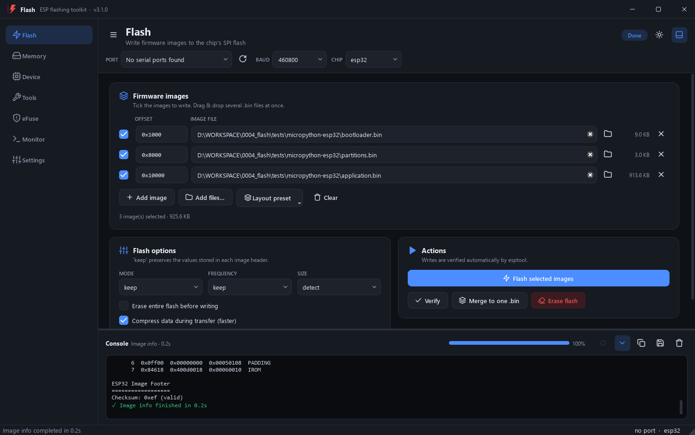
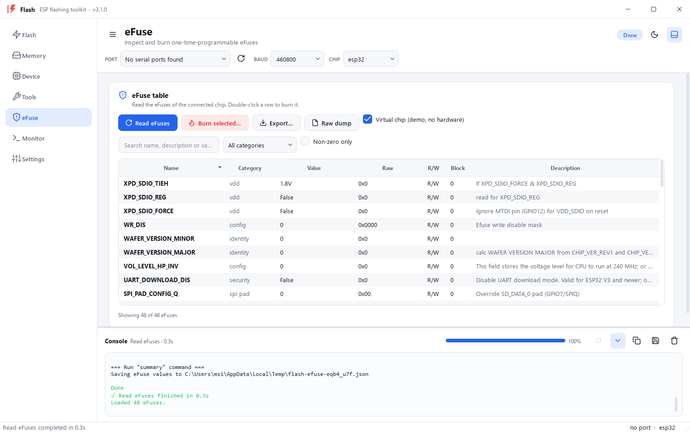
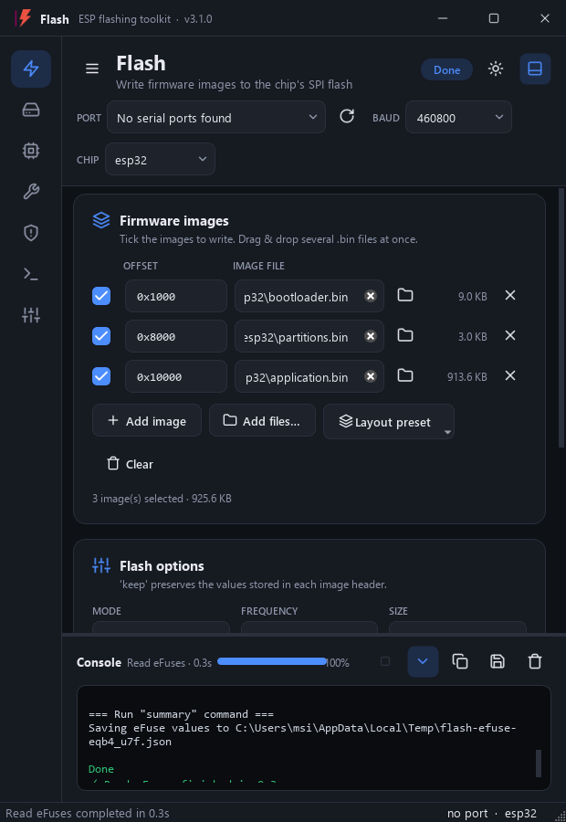

<p align="center">
  
</p>

<h1 align="center">Flash</h1>

<p align="center">
  A modern, cross-platform desktop app to flash, inspect and secure <b>ESP32</b> and <b>ESP8266</b> chips.<br>
  Built on Espressif's official <a href="https://github.com/espressif/esptool">esptool</a> with a Qt 6 interface.
</p>

<p align="center">
  
  
  
  
</p>



## Features

| Page | What you can do |
|------|-----------------|
| **Flash** | Write any number of images at any offsets in one go. Drag & drop `.bin` files and the offsets are guessed from the names (bootloader / partitions / app, or `0x…` in the name). Layout presets for ESP32, S3/C3/C6/H2 and P4/C5. Flash mode / frequency / size, erase-all, compression, skip-already-flashed, **verify**, **merge into one .bin** and **erase flash**. |
| **Memory** | Read flash to a file (or `ALL`), erase a region, peek / poke 32-bit memory words, dump memory, read / write the SPI flash status register. |
| **Device** | Chip ID, MAC address, flash ID & size, security info, load an image into RAM and run it, reset and run the app. |
| **Tools** | ELF → binary, image info (headers, segments, checksum), generate a flash-encryption key and burn it into an eFuse key block. |
| **eFuse** | Read every eFuse into a sortable, searchable table with category and non-zero filters. Burn a value through a dialog that requires you to type the eFuse name. Export to **Excel (.xlsx)** or CSV, or get a raw dump. Also has a **virtual chip** mode for trying things without hardware. |
| **Monitor** | Serial console with timestamps, line-ending choice, a board-reset button, and log saving. It pauses automatically while an operation uses the port, then reconnects. |
| **Settings** | System / light / dark theme, reset strategy (`--before` / `--after`), connect attempts, `--no-stub`, and **profiles** that save every field to a JSON file. |

Shared across all pages:

* **Live console** with colored output, a progress bar with percentage, elapsed time and a **Stop** button (Esc). It can be copied or saved.
* **Hot-plug detection**: serial ports refresh by themselves, and a newly plugged board is selected automatically.
* **Fully responsive**:
  * the sidebar collapses to icons on small windows;
  * cards reflow into 1–3 columns;
  * the connection bar wraps;
  * on very wide screens the console moves beside the pages.
* **HiDPI-sharp**: all icons are vector graphics, and themes follow the OS dark-mode setting.
* Every field is **remembered** between sessions.
* Supports all chips of esptool 5.x: ESP8266, ESP32, ‑S2, ‑S3, ‑C2, ‑C3, ‑C5, ‑C6, ‑C61, ‑H2, ‑P4…

<p align="center">
  
  
</p>

### Keyboard shortcuts

| Keys | Action |
|------|--------|
| `Ctrl+1` … `Ctrl+7` | Switch page |
| `Ctrl+Enter` | Flash selected images |
| `Esc` | Stop the running operation |
| `F5` | Rescan serial ports |
| `Ctrl+J` / `Ctrl+L` | Show/hide console / clear console |
| `Ctrl+T` | Toggle light/dark theme |
| `Ctrl+B` | Collapse/expand sidebar |

## Install

No Python is needed for either option. Download from the [releases page](https://github.com/Gueni/flash/releases).

**Windows**

* **`Flash-<version>-Setup.exe`** is the installer. It installs per user without admin rights (or for all users if you
  choose), adds a Start-menu entry, an optional desktop icon and an uninstaller in *Settings → Apps*. Sample
  MicroPython firmware is included. Installing a newer version upgrades the old one in place.
* **`Flash-<version>-windows-x64.zip`** is the portable version. Unzip it anywhere and run `Flash\Flash.exe`.

Silent install, for IT or scripts: `Flash-<version>-Setup.exe /VERYSILENT /CURRENTUSER`.

**Linux**

```bash
tar xzf Flash-<version>-linux-x86_64.tar.gz
bash Flash-<version>/install.sh          # installs to ~/.local, adds a menu entry and the 'flash-esp' command
bash Flash-<version>/install.sh --uninstall
```

## Run from source

Requirements: **Python 3.10+** (tested with 3.14).

**Windows (PowerShell)**

```powershell
git clone https://github.com/Gueni/flash.git
cd flash
powershell -ExecutionPolicy Bypass -File scripts\setup_venv.ps1
.venv\Scripts\python.exe main.py
```

**Linux**

```bash
git clone https://github.com/Gueni/flash.git
cd flash
bash scripts/setup_venv.sh
.venv/bin/python main.py
```

You can also install it as a package with `pip install .` and then start it with `flash-esp`.

## Build the installer

The build scripts do everything in order:

1. set up the venv and install the dependencies;
2. run the unit tests;
3. build the app with PyInstaller from [`flash.spec`](flash.spec);
4. smoke-test the bundled esptool;
5. package the result.

```powershell
# Windows -> release\Flash-<v>-Setup.exe  +  release\Flash-<v>-windows-x64.zip
powershell -ExecutionPolicy Bypass -File scripts\build.ps1
powershell -ExecutionPolicy Bypass -File scripts\build.ps1 -OneFile    # single portable .exe instead
```

The Windows installer is compiled from [`installer/flash.iss`](installer/flash.iss) with
[Inno Setup 6](https://jrsoftware.org/isinfo.php) (`winget install JRSoftware.InnoSetup`). Without Inno Setup the
script still produces the portable zip.

```bash
# Linux -> release/Flash-<v>-linux-<arch>.tar.gz (with install.sh)
bash scripts/build.sh
bash scripts/build.sh --install     # ...and install it for the current user
bash scripts/build.sh --onefile     # single portable binary instead
```

PyInstaller can't cross-compile, so build the Windows installer on Windows and the Linux package on Linux.

## Project layout

```
flash/
├── main.py                  # launcher: python main.py (also the PyInstaller entry)
├── flash.spec               # PyInstaller build definition
├── installer/flash.iss      # Inno Setup script (Windows installer)
├── pyproject.toml           # package metadata (pip install .)
├── requirements.txt         # runtime deps      requirements-dev.txt -> + PyInstaller
├── scripts/                 # setup_venv.{ps1,sh}, build.{ps1,sh}, install_linux.sh
├── assets/img/              # README screenshots
├── tests/                   # unit tests (test_flash_core.py) + sample firmware/images
└── src/flash/
    ├── app.py               # QApplication setup, --run-tool dispatch
    ├── settings.py          # persistent state + JSON profiles
    ├── assets/              # app icon and logo (bundled)
    ├── core/                # no GUI code in here
    │   ├── tools.py         # esptool/espefuse/espsecure invocation, arg builders, output parsing
    │   ├── runner.py        # QProcess runner: streaming output, progress, stop
    │   ├── serial_monitor.py
    │   └── efuse.py         # eFuse JSON parsing + xlsx/csv export
    └── ui/
        ├── theme.py         # light/dark palettes -> Qt stylesheet
        ├── icons.py         # inline SVG icon set
        ├── widgets.py       # FlowLayout, ResponsiveGrid, Card, inputs, Console, Toast
        ├── main_window.py   # sidebar, connection bar, console, responsive behaviour
        └── pages/           # flash, memory, device, tools, efuse, monitor, settings
```

### How the tools run

Every operation runs in a **separate process**, so a hung transfer can always be stopped and never freezes the
window:

* **From source:** the app runs `python -m esptool …`.
* **In the packaged exe:** there is no Python interpreter, so the exe starts itself again as
  `Flash.exe --run-tool esptool …`, and that copy runs the bundled esptool.

In both cases the output is parsed live for progress and errors.

## Tests

```bash
python -m unittest tests.test_flash_core -v
```

The tests cover argument building, number parsing, progress parsing and eFuse parsing/export. They also run the
real tools offline: `image-info` on the sample firmware, and an `espefuse --virt` summary. No board is needed.
The other `tests/test_*.py` files are the legacy upstream esptool 2.x suites, and they need hardware.

## Troubleshooting

| Problem | Fix |
|---------|-----|
| `AttributeError: module 'serial' has no attribute 'Serial'` | The wrong PyPI package `serial` is installed and hides **pyserial**. Run `pip uninstall serial` and then `pip install --force-reinstall pyserial`. The setup scripts do this for you. |
| Linux: `Permission denied: '/dev/ttyUSB0'` | Run `sudo usermod -aG dialout $USER`, then log out and back in. Don't run the app with sudo. |
| Linux: `Could not load the Qt platform plugin "xcb"` | Run `sudo apt install libxcb-cursor0` (or the equivalent package for your distro). |
| `Failed to connect to ESP32: No serial data received` | Hold **BOOT**, tap **EN/RESET**, then try again. Or, in Settings, set *Before* to `no-reset` and put the chip in download mode by hand. A lower baud rate can also help. |
| Port busy | Close other serial monitors. Flash's own monitor pauses itself while an operation runs. |

## Credits

* [esptool / espefuse / espsecure](https://github.com/espressif/esptool) by Espressif Systems and contributors
  (GPL-2.0-or-later). Flash drives these tools and bundles them in the packaged executable.
* [Qt for Python (PySide6)](https://doc.qt.io/qtforpython-6/) and [pySerial](https://github.com/pyserial/pyserial).
* Author: [Mohamed Gueni](https://github.com/Gueni). Issues and pull requests are welcome.
